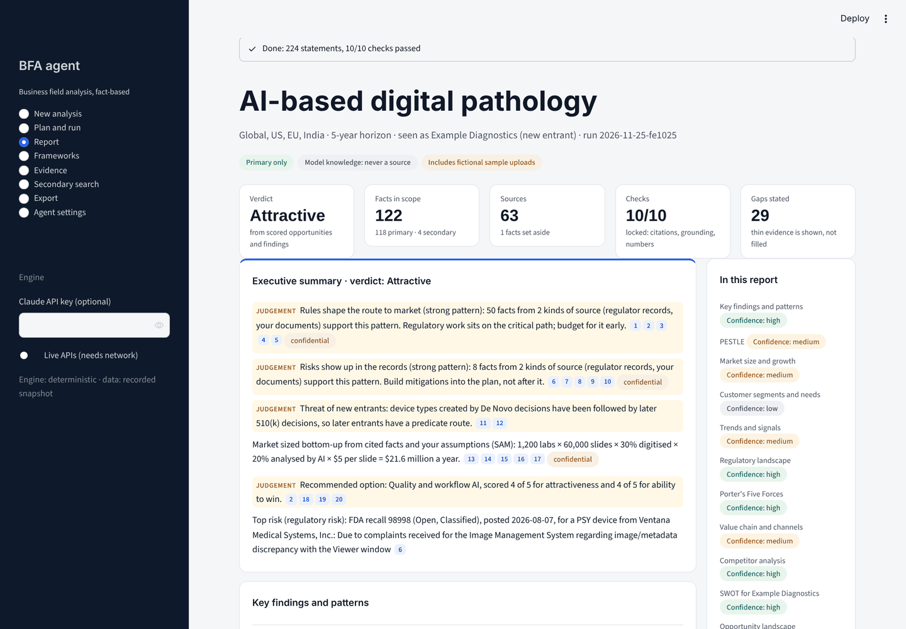
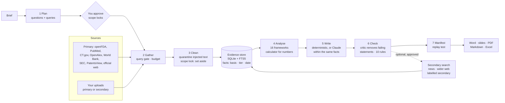
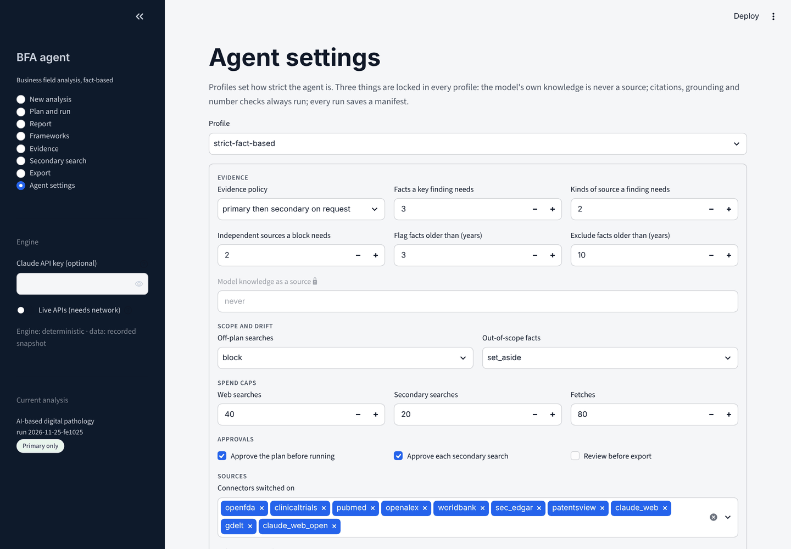

# Business Field Analysis agent

[](https://github.com/muralimohan85/business-field-analysis-agent/actions/workflows/ci.yml)
[](https://codespaces.new/muralimohan85/business-field-analysis-agent?quickstart=1)

**A business field analysis agent that only says what its sources say.** You describe a field: what it is, where, the
time horizon, and how you look at it (new entrant, incumbent, investor). The agent plans the research, pulls evidence
from open databases (regulators, papers, trials, patents, statistics, filings) and from your own documents, and fills
the strategy frameworks: PESTLE, market size and growth, customer segments, trends, Porter's five forces, value chain,
competitors, SWOT, opportunity landscape, business model canvas, key findings, recommendations, and risks and
assumptions. It then exports the result as Word, slides or PDF.

Every sentence cites a stored fact. Every number comes from a cited fact or the calculator. Where the evidence is thin,
the report says so instead of filling the gap. The model's own knowledge is never a source.



## Try it

No API key or network needed: the demo replays recorded data.

```bash
pip install -r requirements.txt
make app        # Streamlit app, opens on the demo report
make demo       # same analysis from the command line; writes every export to examples/digital-pathology/
make test       # 67 tests
make eval       # governance evaluation (seeded faults, drift, replay)
```

Or open it in Codespaces with the badge above. The finished demo outputs are committed in
[`examples/digital-pathology/`](examples/digital-pathology/): the [full report](examples/digital-pathology/report.md)
(Markdown, [Word](examples/digital-pathology/report.docx), [slides](examples/digital-pathology/report.pptx),
[PDF](examples/digital-pathology/report.pdf)), a [decision brief](examples/digital-pathology/decision-brief.pdf), a
[one-pager](examples/digital-pathology/one-page.pdf), the [Excel evidence pack](examples/digital-pathology/report.xlsx)
and the [run manifest](examples/digital-pathology/manifest.json).

## The demo: AI-based digital pathology

| | |
|---|---|
| **Brief** | Whole-slide imaging and AI software for diagnosis and lab workflow; Global, US, EU and India; 5 years; seen as a new entrant ([brief](data/demo/digital_pathology/brief.yaml)) |
| **Real data** | Every openFDA record for five device product codes (PSY scanning, QKQ and PZZ viewing, QPN and SIX AI): classifications, 510(k) and De Novo decisions, recalls. Recorded on 25 Nov 2026 ([snapshot](data/snapshots/digital-pathology-real/openfda/)). |
| **Fictional uploads** | A lab survey from an invented company, Example Diagnostics (your own data, primary), and a brochure from an invented vendor, Lumen Slide Systems (third party, secondary), which also carries an instruction aimed at AI tools. Both say they are fictional on every page and are labelled wherever cited. |
| **Result** | 63 sources, 224 cited statements, 6 findings (2 strong), 29 gaps stated, 1 sentence quarantined, 10 of 10 checks passed. The bottom-up market (SAM) is $21.6 million a year from the survey's lab counts and your four labelled assumptions. The recommended option is quality and workflow AI, scored 4 of 5 for attractiveness and 4 of 5 for ability to win. |

The other connectors (PubMed, ClinicalTrials.gov, OpenAlex, World Bank, SEC EDGAR, PatentsView, Claude web search,
GDELT) are implemented and tested on payloads in each API's shape, but the machine I built this on could reach only the
openFDA API. So the demo shows their planned queries as *skipped: not in the snapshot*, and the report states the gaps
they leave. Run `make record` on a machine with network access to record a full real snapshot; see
[Recording real data](#recording-real-data).

## What it does

| You asked for | How the agent does it |
|---|---|
| Look at open databases for trends, facts, metrics, numbers and papers | Connectors for [openFDA](bfa/connectors/regulatory.py), [PubMed, OpenAlex, ClinicalTrials.gov](bfa/connectors/science.py), [World Bank, SEC EDGAR, PatentsView](bfa/connectors/markets.py), and [Claude web search restricted to official domains](bfa/connectors/web.py) (regulators, statistics offices, `.gov`). Each returns facts with source, date, basis and tier. |
| Fetch details online for a given input | The [planner](bfa/planner.py) turns the brief into questions (one per framework, plus yours) and the queries that serve them. [Domain packs](config/packs/health.yaml) supply codes and vocabulary, such as FDA product codes, CPC patent classes and World Bank series. |
| Fill PESTLE, SWOT, competitors, opportunities, BMC, value chain and more | 16 [framework builders](bfa/frameworks/), 13 on by default. Each reads only stored facts. Synthesis (findings, SWOT, opportunities, recommendations, risks) runs last and reads the sections built before it. |
| Market size and growth, customers, value chain and channels, findings, recommendations, risks and assumptions | Published estimates are shown side by side, never averaged. A bottom-up SAM and SOM is computed from cited counts and your labelled assumptions, with a sensitivity line. Findings need 3 facts from 2 kinds of source, or they are shown as signals. |
| Upload your own documents | PDF, Word, PowerPoint, Excel, CSV and text. You mark each file as your own data (primary) or a third-party report (secondary). Uploads are confidential: an export marks or removes their statements. |
| Export the summary as Word, slides or PDF | [`bfa/report/export.py`](bfa/report/export.py): Word, PowerPoint, PDF, Markdown and an Excel evidence pack, in four scopes (one page, decision brief, full, custom). Every format uses the same source numbers. |
| Fact-based, from the primary search only | The report is built from primary sources only. Secondary sources (news, press releases, research firms, the wider web) come in only through an optional secondary search. |
| Optional secondary search | You choose which open questions, sections or questions of your own it serves, and approve it as a plan amendment. Results are labelled secondary, and a switch rebuilds the report with or without them. |
| Governed so it does not drift | The scope locks when you approve the plan. A [query gate](bfa/governance/gate.py) blocks searches that serve no planned question. Models are pinned. Every run saves a manifest, and a [replay test](bfa/pipeline.py) compares evidence hashes. |
| Configure the agent | [Profiles](config/profiles/) (`strict-fact-based`, `exploratory`, `regulated-health`) and an *Agent settings* screen: evidence policy, thresholds, age limits, scope behaviour, spend caps, approvals, connectors, official domains, checks, models. Three settings are locked in every profile. |

## How it works



## The ten rules

| # | Rule | Enforced by |
|---|---|---|
| 1 | No source, no sentence. Model knowledge is never a source. | `citations` and `grounding` checks (locked); the Claude writer only sees the facts a block already cites |
| 2 | Numbers come from cited facts or the calculator | `numbers` check (locked): every figure in a statement must appear in a cited fact or a calculator input |
| 3 | Differing estimates are shown side by side, never averaged | market builder shows ranges; the `numbers` check rejects averaged estimates |
| 4 | Gaps are stated | a block needs 2 independent sources, otherwise it carries a gap; a finding needs 3 facts from 2 kinds of source, otherwise it is a signal |
| 5 | Frameworks agree | `agreement` check: a fact is not both an opportunity and a threat; the recommended option is the top-scored one; the summary cites only facts the sections use |
| 6 | Source text is data, not instructions | [sanitiser](bfa/safety/sanitizer.py) quarantines instruction-like sentences before any engine reads them |
| 7 | Uploads are confidential | statements from your uploads are marked or removed on export; uploads are never used as web search queries |
| 8 | Age, tier and basis are visible | every citation shows basis, tier and date; facts older than N years are flagged, older than M years excluded |
| 9 | Spend is capped | caps on web searches, secondary searches and fetches; skipped calls are listed |
| 10 | Stay in scope and on plan | scope lock after approval; query gate blocks off-plan searches; out-of-scope facts are set aside with the reason |

## Evaluation

[`evaluation/run_eval.py`](evaluation/run_eval.py) mutates every statement in the demo report in seven ways a writer
could get wrong, tries 22 drifting queries against the gate, and replays the run. It runs in CI.
[Results](evaluation/results.md):

| Fault seeded into the demo report | Seeded | Caught |
|---|---|---|
| Number changed | 143 | 143 |
| Citation removed | 224 | 224 |
| Cites a secondary fact in a primary-only report | 60 | 60 |
| Instruction injected | 224 | 224 |
| Cites a fact the scope lock set aside | 60 | 60 |
| Unsupported claim with real citations | 60 | 60 |
| Market estimates averaged | 60 | 60 |

There were no false alarms on the 224 original statements. All 28 planned queries passed the gate and all 22 drifting
queries were blocked. The replay gave the same evidence hash and the same 224 statements.

## Configuration

```yaml
# config/profiles/regulated-health.yaml
evidence:
  policy: primary_only          # or primary_then_secondary_on_request (default), primary_then_secondary_for_gaps
  finding_min_facts: 4
  flag_after_years: 2
approvals:
  review_before_export: true
```

Locked in every profile: `evidence.model_knowledge: never`; the `citations`, `grounding` and `numbers` checks; and
`run_manifest: true`. The settings model rejects a profile that changes them
([`bfa/config.py`](bfa/config.py)).



## Command line

```bash
python -m bfa plan --brief my_brief.yaml                       # review the plan; nothing is fetched
python -m bfa run --brief my_brief.yaml --yes --mode live \
   --upload notes.pdf:primary --export docx,pptx,pdf --scope decision_brief
python -m bfa secondary workspace/runs/<id> --gaps 5 --sections market_size --yes
python -m bfa replay workspace/runs/<id>                       # drift test
python -m bfa export workspace/runs/<id> --format pdf --scope one_page --confidential remove
python -m bfa --profile regulated-health settings              # print the merged settings
python -m bfa sources                                          # connectors and whether they are ready
```

## Claude engine

Without a key, the deterministic engine writes every statement from templates over the facts, and it runs offline. With
`ANTHROPIC_API_KEY` set (or a key pasted in the app's sidebar):

* **Planner** (`claude-opus-5-5`) proposes search vocabulary only (keywords, scope and exclude terms,
  segments, stages). You see the result in the plan before you approve it.
* **Writer** (`claude-opus-5-5`) rewrites each section through a tool with a strict schema. It
  receives only the facts the block already cites and must cite from that list. The same critic then checks each
  statement, and a block whose rewrite fails keeps its deterministic text. A bad answer can only make a block plainer,
  not wrong.
* **Web search** (`claude-sonnet-5-5`) uses the server-side `web_search` and `web_fetch` tools. For the primary search, `allowed_domains` is
  set to the official domains in the settings, and only quoted, cited passages become facts. The secondary search can
  use the wider web, and its results are labelled.

Every Claude call is recorded and replayed like a connector call, so a Claude run can be repeated exactly. The models
are pinned in [`config/agent.yaml`](config/agent.yaml). Claude Opus 5.5 rejects forced tool choice and sampling
parameters, so calls use `tool_choice: auto` with strict tool schemas and send no temperature. If the API refuses a
call (a wrong key, no credit, a rejected parameter), the run carries on: each section keeps its deterministic text and
the report shows why.

## Recording real data

```bash
cp .env.example .env    # OPENALEX_API_KEY and PATENTSVIEW_API_KEY are free; BFA_CONTACT_EMAIL for SEC EDGAR
make record             # runs every connector live and saves each response under data/snapshots/recorded-<date>/
python -m bfa run --brief data/demo/digital_pathology/brief.yaml --yes --snapshot recorded-<date> --export docx,pdf
```

## Connectors

| Connector | Basis | Key | Gives |
|---|---|---|---|
| openFDA | primary | optional | device classifications, 510(k)/De Novo decisions, recalls |
| PubMed (E-utilities) | primary | optional | papers per year |
| OpenAlex | primary | free, required | papers per year, top institutions |
| ClinicalTrials.gov v2 | primary | none | trials, starts per year, sponsors |
| World Bank Indicators | primary | none | health spending, ageing and other series |
| SEC EDGAR XBRL | primary | contact email | company revenue from filings |
| PatentsView | primary | free, required | patents per year, top assignees |
| Claude web search (official domains) | primary | Claude API | quoted passages from regulators and statistics offices |
| GDELT | secondary | none | news coverage (secondary search only) |
| Claude web search (wider web) | secondary | Claude API | quoted passages (secondary search only) |
| Your uploads | you choose | — | facts from PDF, Word, PowerPoint, Excel, CSV and text |

Planned, listed in [`config/sources.yaml`](config/sources.yaml): IMF, OECD, Eurostat, UN Comtrade, GLEIF, Semantic
Scholar, Europe PMC, arXiv, Crossref, EPO OPS, Wikidata, company newsrooms.

## Honest notes

* **Grounding is lexical.** For written (non-judgement) statements, the check needs most of the statement's terms to
  appear in the cited facts. It catches invented claims and wrong numbers. It cannot catch a misreading that reuses the
  source's own words, so the report labels judgements as judgements and links every claim, and you should still read
  the sources behind a decision.
* **Scores are a fixed, visible rubric, not a model.** Opportunity scores come from counts of tailwinds, headwinds,
  customer facts and companies already holding records. The rubric is printed under the chart, and every score is a
  calculated fact you can trace.
* **The demo's real evidence is regulatory only.** So the market and customer sections lean on the fictional survey,
  and the report says so. A recorded run with all connectors fills more of them.
* **With the Claude engine, cited upload passages go to the Claude API.** The writer sees the facts a block cites,
  which can include passages from your uploads. Uploads are never used as web search queries. Use the deterministic
  engine for documents that must not leave your machine.
* **The current year is partial.** Decisions in 2026 are reported as year to date and are not compared with full years.
* **Deterministic "so what" lines are templates per theme.** They are marked as judgements. The Claude writer replaces
  them with sentences written from the cited facts, under the same checks.
* This is a portfolio project, not investment, legal or regulatory advice.

More on the design choices: [`docs/design-decisions.md`](docs/design-decisions.md).

## Layout

```
bfa/
  planner.py            brief -> plan (questions, queries, scope terms)
  pipeline.py           the seven steps, manifest, replay test
  secondary.py          optional secondary search and the include/exclude switch
  connectors/           openFDA, PubMed, OpenAlex, ClinicalTrials.gov, World Bank, SEC, PatentsView, web, GDELT
  ingest/uploads.py     PDF, DOCX, PPTX, XLSX, CSV, TXT -> facts
  governance/           query gate, scope lock, budget
  safety/sanitizer.py   quarantine of instruction-like text
  frameworks/           environment (PESTLE, Porter, regulatory), market, players, synthesis
  checks/               the critic and the ten rules
  engines/claude.py     Claude planner and writer (recorded, replayable)
  report/               document model, charts, Word / slides / PDF / Markdown / Excel
app/                    Streamlit app
config/                 agent.yaml, profiles/, frameworks.yaml, rules.yaml, sources.yaml, packs/
data/                   demo brief, sample uploads, recorded snapshots
evaluation/             seeded-fault, drift and replay evaluation
examples/               the demo's exported outputs
tests/                  67 tests (pipeline, checks, governance, connectors, exports, Claude engine, app)
```

## License

MIT
